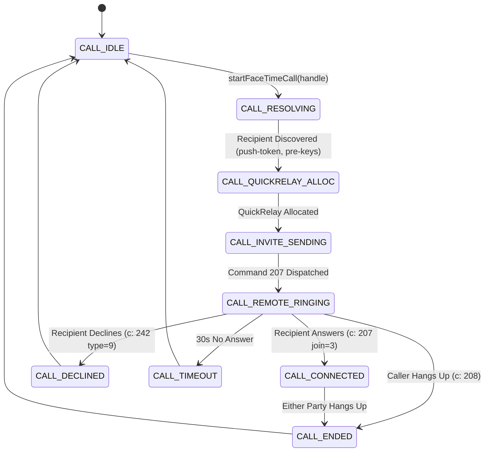

# FaceTime Outgoing Signaling & Directory Lookup Specification

> **Project**: FaceTime Android Standalone Proof-of-Concept  
> **Document**: `docs/architecture/facetime_signaling.md`  
> **Source References**: `vendor/rustpush/src/facetime.rs:140-1920`, `vendor/rustpush/src/ids/identity_manager.rs:620-680`, `vendor/rustpush/src/ids/user.rs:960-1010`  
> **Protocol Components**: `id-query` WebTunnel, QuickRelay Command 200, Outgoing Invite PDU Command 207 (`FTWireMessage`), Protobuf Schemas, Command Taxonomy, Call State Lifecycle  
> **Version**: 1.0 (Milestone 1 Architecture Baseline)  

---

## 1. Directory Lookup Protocol (`id-query` over WebTunnel)

Before initiating a FaceTime call, the caller must resolve the recipient's handle (e.g. `mailto:recipient@example.com`) to determine:
1. Whether the recipient is FaceTime-capable.
2. The recipient's active 32-byte APNS push tokens.
3. Apple relay session routing tokens.
4. The recipient's public encryption keys (`public-message-identity-key` and NGM pre-keys).

```
[Android Client]
       │
       │ 1. APNS Frame 0x0a (Command 96: WebTunnel HTTP POST to id-query)
       │    Topic: com.apple.private.alloy.facetime.multi
       ▼
[Apple Push Gateway (APNS Courier)]
       │
       │ 2. Edge Proxy routes query to IDS Directory Cluster
       ▼
[Apple IDS Directory (init.ess.apple.com)]
       │
       │ 3. Resolves Handle -> Discovers Target iPhone APNS Token & Public Keys
       ▼
[Apple Push Gateway (APNS Courier)]
       │
       │ 4. APNS Frame 0x0a (WebTunnel Response Plist)
       ▼
[Android Client] (Extracts IDSLookupResp: Push Token, Session Token, P-256 PreKey)
```

### 1.1 WebTunnel Framing (Command 96)
Apple encapsulates HTTP requests over persistent APNS push streams via **WebTunnel**:
- **Outer Frame**: Binary Plist with command `c: 96`.
- **Destination Topic**: `com.apple.private.alloy.facetime.multi`.

```xml
<plist version="1.0">
<dict>
    <key>c</key>
    <integer>96</integer>
    <key>U</key>
    <data>16_BYTE_MESSAGE_UUID</data>
    <key>url</key>
    <string>https://init.ess.apple.com/WebObjects/VCInit.woa/wa/id-query</string>
    <key>headers</key>
    <dict>
        <key>x-protocol-version</key>
        <string>1760</string>
        <key>content-type</key>
        <string>application/x-apple-plist</string>
        <key>content-encoding</key>
        <string>gzip</string>
    </dict>
    <key>body</key>
    <data>GZIPPED_BINARY_PLIST_QUERY_BODY</data>
</dict>
</plist>
```

### 1.2 Query Payload Schema
The gzipped request body contains the requested recipient handles:
```xml
<plist version="1.0">
<dict>
    <key>uris</key>
    <array>
        <string>mailto:recipient@example.com</string>
    </array>
</dict>
</plist>
```

### 1.3 `IDSLookupResp` Response Data Structure
The directory returns an entry for each enrolled Apple device associated with the handle:
- **`push-token`**: 32-byte APNS push token used to route the call invitation directly to the recipient's device.
- **`session-token`**: Dynamic token signed by Apple's relay network authorizing peer-to-peer signaling delivery.
- **`client-data`**:
  - `public-message-identity-key`: Recipient's RSA 1280 public key (DER bytes).
  - `public-message-ngm-device-prekey-data-key`: Protobuf bytes containing the recipient's NIST P-256 pre-key.
  - `ngm-public-identity`: Recipient device P-256 public identity point.

### 1.4 WebTunnel Error 5206 Handling (Response Too Large)
If an Apple Account has dozens of registered devices or aliases, the directory response can exceed APNS frame size limits, returning HTTP status `5206` (*Response Too Large*):
- **Recovery Algorithm**: Recursively bisect the URI request list into halves (`chunks(len / 2)`), dispatch independent parallel queries, and merge the returned device lists.

---

## 2. QuickRelay Allocation (`command: 200`)

FaceTime signaling requires allocating Apple media and signaling relay servers before dispatching the invitation PDU:

- **Command Code**: `c: 200`
- **Request Parameters**:
  - `c`: `200`
  - `qids`: Call session UUID string (e.g. `B6D55E02-8618-477D-9D22-C119E1552317`).
  - `qgid`: Group conversation UUID string.
  - `qat`: `3` (Allocation type).
  - `qgmc`: Member count (`2` for 1-to-1 calling).
- **Server Allocation Response**:
  - Received on topic `com.apple.private.alloy.quickrelay`.
  - Yields Relay Server IPv4/IPv6 address, UDP port, and QuickRelay authorization ticket.

---

## 3. Outgoing FaceTime Invite PDU (`command: 207`) Wire Structure

The decisive signaling transaction that causes the recipient iPhone to ring natively is the transmission of the **Command 207 `FTWireMessage` Invite PDU**.

```
+-----------------------------------------------------------------------------------+
|               Outer IDS Relay Envelope (Command 207 Plist)                        |
|  - c: 207, ua: macOS/iOS UserAgent, v: 8, sP: mailto:caller@example.com           |
|  - dtl: [ { tP: mailto:recipient, t: PushToken, sT: SessionToken, E: pair-ec } ]  |
+-----------------------------------------------------------------------------------+
                                          │
                                          │ Encrypted under Recipient P-256 PreKey
                                          ▼
+-----------------------------------------------------------------------------------+
|                     Inner FTWireMessage (Plaintext Plist)                         |
|  - s: Call UUID, fanout-groupID-key, join_notification_key: 1 (Invite)            |
|  - participant-id-key: 64-bit random ID, fanout-groupMembers-key                  |
|  - client_context_data_key: Protobuf ConversationParticipantDidJoinContext       |
+-----------------------------------------------------------------------------------+
```

### 3.1 Outer IDS Envelope Plist (Dispatched to Courier)
```xml
<plist version="1.0">
<dict>
    <key>c</key>
    <integer>207</integer>
    <key>ua</key>
    <string>[macOS,14.5,23F79,MacBookPro18,1]</string>
    <key>v</key>
    <integer>8</integer>
    <key>i</key>
    <integer>9823412</integer>
    <key>U</key>
    <data>16_BYTE_MESSAGE_UUID</data>
    <key>sP</key>
    <string>mailto:caller@example.com</string>
    <key>dtl</key>
    <array>
        <dict>
            <key>tP</key>
            <string>mailto:recipient@example.com</string>
            <key>t</key>
            <data>32_BYTE_RECIPIENT_PUSH_TOKEN</data>
            <key>sT</key>
            <data>RECIPIENT_SESSION_TOKEN</data>
            <key>E</key>
            <string>pair-ec</string>
            <key>D</key>
            <false/>
            <key>P</key>
            <data>ENCRYPTED_FTWIREMESSAGE_BYTES</data>
        </dict>
    </array>
    <key>is-initiator-key</key>
    <true/>
    <key>up1</key>
    <false/>
</dict>
</plist>
```

### 3.2 Inner `FTWireMessage` Plist (Payload `P` before Encryption)
```xml
<plist version="1.0">
<dict>
    <key>s</key>
    <string>B6D55E02-8618-477D-9D22-C119E1552317</string>
    <key>fanout-groupID-key</key>
    <string>B6D55E02-8618-477D-9D22-C119E1552317</string>
    <key>is-initiator-key</key>
    <true/>
    <key>is_u_plus_one_key</key>
    <false/>
    <key>join_notification_key</key>
    <integer>1</integer>
    <key>participant-id-key</key>
    <integer>183921049281729381</integer>
    <key>fanout-groupMembers-key</key>
    <array>
        <string>mailto:caller@example.com</string>
        <string>mailto:recipient@example.com</string>
    </array>
    <key>uri_to_participant_id_key</key>
    <dict>
        <key>mailto:caller@example.com</key>
        <array>
            <integer>183921049281729381</integer>
        </array>
    </dict>
    <key>participant_data_key</key>
    <data>VCMediaNegotiationBlob_BYTES</data>
    <key>client_context_data_key</key>
    <data>PROTOBUF_ConversationParticipantDidJoinContext_BYTES</data>
</dict>
</plist>
```

---

## 4. Protobuf Schema Definitions

The `client_context_data_key` binary blob is an encoded Protocol Buffer message defining call capabilities and alerting preferences:

```protobuf
syntax = "proto3";
package apple.facetime;

message ConversationParticipantDidJoinContext {
    uint32 version = 1;
    repeated ConversationMember members = 2;
    ConversationMessage message = 3;
    bool isScreenSharingAvailable = 9;
    bool isGondolaCallingAvailable = 15;
    uint32 sharePlayProtocolVersion = 17;
    optional uint32 visionFeatureVersion = 26;
    optional uint32 visionCallEstablishmentVersion = 27;
}

message ConversationMessage {
    uint32 version = 1;
    ConversationMessageType type = 2;
    string conversationGroupUUIDString = 5;
    ConversationReport reportData = 12;
    repeated ConversationInvitationPreference invitationPreferences = 19;
}

enum ConversationMessageType {
    UNKNOWN = 0;
    INVITATION = 1;
    UPGRADE = 2;
    JOINED = 3;
    RESPONDED_ELSEWHERE = 6;
    DECLINE = 9;
}

message ConversationMember {
    string handle = 1;
    uint64 participantID = 2;
}

message ConversationReport {
    string reportUUID = 1;
    uint64 timestampMs = 2;
}

message ConversationInvitationPreference {
    uint32 preferenceType = 1;      // 1: PhoneNumber, 2: Generic, 3: Email
    uint32 notificationStyles = 2;  // 1: Standard Ringing Alert
}
```

---

## 5. Signaling Command Code Taxonomy

| Command Code | Name | Direction | Key Payload Attributes | Description |
|---|---|---|---|---|
| **`c: 200`** | `QuickRelayAlloc` | Client $\to$ Courier | `qids`, `qgid`, `qat: 3`, `qgmc: 2` | Pre-allocates Apple media relay nodes for call establishment. |
| **`c: 207`** | `Invite / Ring` | Client $\to$ Courier | `join_notification_key: 1`, `dtl` | **Primary Outgoing Invite**. Causes physical recipient iPhone to ring with native SpringBoard UI. |
| **`c: 208`** | `Leave / Hangup` | Client $\leftrightarrow$ Courier | `join_notification_key: 2`, `cc: 1`, `H: 3` | Terminates active call or cancels outgoing invite before answer. |
| **`c: 209`** | `Update` | Client $\leftrightarrow$ Courier | `fanout-groupMembers-key` | Updates session roster (e.g. adding participants to group FaceTime). |
| **`c: 210`** | `Connect` | Client $\leftrightarrow$ Courier | `siu: false` | Completes session establishment once recipient accepts. |
| **`c: 242`** | `Control` | Courier $\to$ Client | `ConversationMessage` proto | Discrete control updates: `DECLINE`, `RESPONDED_ELSEWHERE`, `BUSY`. |

---

## 6. Call State Progression & Remote Ringing Sequence



### The Decisive Ringing Verification
1. Caller executes `startFaceTimeCall("recipient@example.com")`.
2. State transitions to `CALL_INVITE_SENDING`.
3. APNS delivers notification `0x0a` to the physical iPhone.
4. The iPhone's `CallKit` and SpringBoard display the native full-screen incoming call UI:
   - Caller Name: `"caller@example.com"`
   - Service: `"FaceTime Video"` or `"FaceTime Audio"`
   - Actions: `"Accept"` and `"Decline"` buttons with default ringtone playing.
5. Fulfills the primary Milestone 4 PoC V0 success criterion without external hardware.
