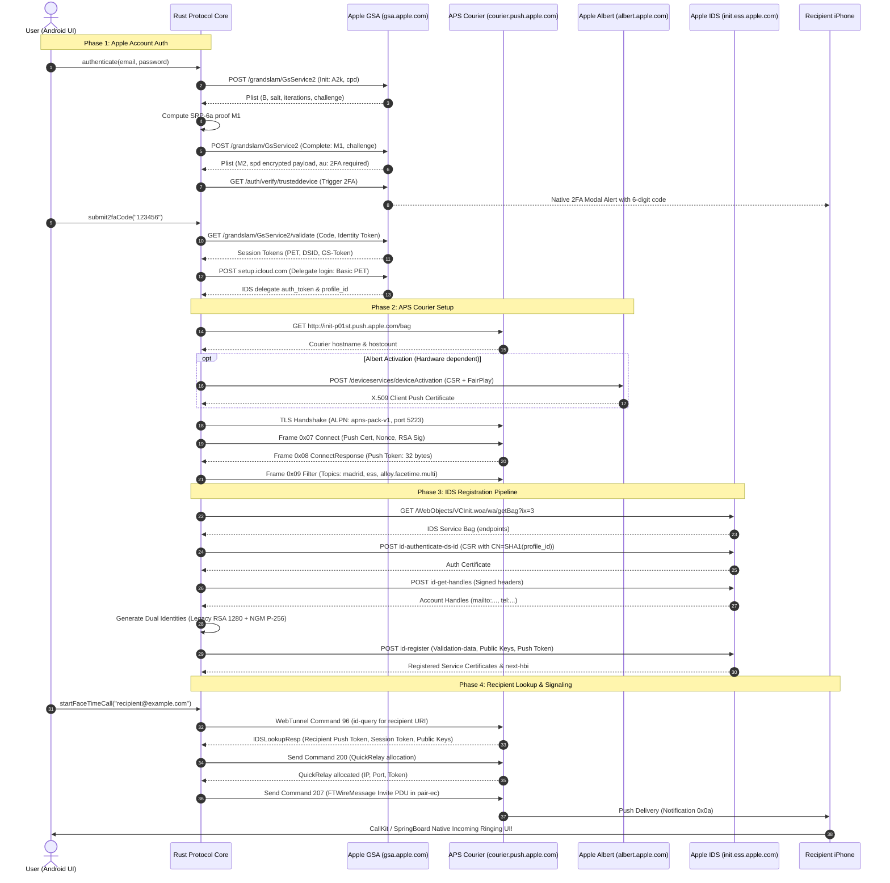

# End-to-End Architecture & Protocol State Transitions

> **Project**: FaceTime Android Standalone Proof-of-Concept  
> **Document**: `docs/architecture/overview.md`  
> **Target Scope**: Clean-room Android PoC investigating whether a standalone clean Android phone (without Apple hardware, donor credentials, companion servers, or remote bridges) can independently authenticate with Apple services (APS/IDS/FaceTime) and trigger a genuine incoming native FaceTime call on an iPhone.  
> **Version**: 1.0 (Milestone 1 Architecture Baseline)  

---

## 1. Executive Summary & Research Mission

### 1.1 The Core Research Thesis
Can a standalone, clean-room Android client running native Rust protocol logic independently authenticate with Apple services, maintain a persistent Apple Push Notification service (APS) courier connection, register dual-layer cryptographic identities with Apple Identity Services (IDS), and transmit an outgoing invite PDU that causes a genuine physical iPhone to ring natively with the stock incoming FaceTime call UI?

This project investigates this question under strict clean-room engineering constraints:
- **Zero Apple Hardware**: No physical Macs, iPhones, or iPads acting as bridges, relay hosts, or donor device farms.
- **Zero Donor Credentials / Artifacts**: No extracted identity certificates, serial numbers, main logic board (MLB) identifiers, or ROM MAC addresses harvested from genuine Apple devices.
- **Zero External Bypass APIs**: No cloud-hosted verification endpoints or remote validation services.
- **Pure Standalone Protocol Execution**: All cryptographic handshakes (SRP-6a, RSA-OAEP, P-256 ECDH, AES-GCM, AES-CTR), binary wire codecs (`apns-pack-v1`, Apple binary plist, Protobuf), and network sessions run directly on the Android host device.

### 1.2 Scope of PoC V0: The Decisive Ringing Test
The primary Definition of Done (DoD) for PoC V0 is strictly focused on **incoming call signaling**:
1. Outgoing FaceTime invitation PDU (`c: 207`, `FTWireMessage`) generated by Android client.
2. Delivered across Apple's push infrastructure to recipient iPhone's APNS token.
3. Physical recipient iPhone receives push notification and rings natively in SpringBoard/CallKit UI without requiring web links, SMS, or companion apps.

Production media pipelines (AVConference RTP/RTCP, SRTP key derivation, H.264/HEVC video codecs, AAC-ELD audio codecs) are explicitly deferred until standalone registration and outgoing ringing signaling are conclusively proven.

---

## 2. Layered System Architecture

The project architecture comprises five decoupled layers:

```
+-----------------------------------------------------------------------------------+
|                        Android Native Layer (android/)                            |
|  - Jetpack Compose UI (Auth, APS Courier Status, 7-Stage IDS Stepper, Call Pad)  |
|  - ApsConnectionService (Foreground Service with NetworkCallback Handover)         |
|  - Android Keystore Security (MasterKey AES-256-GCM + EncryptedSharedPreferences) |
|  - Diagnostic Exporter (Circular Ring Buffer 2048, Multi-Tier Regex Redaction)    |
+-----------------------------------------------------------------------------------+
                                          ▲
                                          │ UniFFI Bridge (C-ABI / Kotlin Bindings)
                                          ▼
+-----------------------------------------------------------------------------------+
|                       Rust Protocol Core (rust/facetime-core/)                    |
|  - auth: GrandSlam GSA SRP-6a, 2FA Challenge Handler, Delegate Token Client       |
|  - aps: Courier TLS Transport (tokio-rustls), apns-pack-v1 Codec, Topic Router    |
|  - ids: VCInit Bag, Dual RSA/NGM Keypairs, Madrid/ESS Multi-Key Header Signer     |
|  - facetime: id-query WebTunnel Directory Lookup, QuickRelay, FTWireMessage 207   |
|  - state: Central Protocol State Machine & Event Dispatcher                       |
+-----------------------------------------------------------------------------------+
                                          ▲
                                          │ Trait Interface & Dynamic Dispatch
                                          ▼
+-----------------------------------------------------------------------------------+
|              Device Validation Abstraction (DeviceValidationProvider)             |
|  - MockValidationProvider (Deterministic synthetic data, flagged MOCK MODE)       |
|  - ExistingRustpushValidationProvider (Baseline reference audit pipeline)          |
|  - AndroidExperimentalValidationProvider (Zero-donor clean-room Android provider) |
|  - Hard Go/No-Go Decision Gate (Halts feature dev upon Apple validation reject)   |
+-----------------------------------------------------------------------------------+
                                          ▲
                                          │ Subcrate / Path Imports
                                          ▼
+-----------------------------------------------------------------------------------+
|                 Vendored Research Base (vendor/rustpush/, patches/)               |
|  - Pristine OpenBubbles rustpush tree (commit b3c96c2)                            |
|  - Upstream submodules: apple-private-apis, open-absinthe, quinn, rtc, rustls     |
|  - vendor/patches/ (Numbered atomic patch series with zero silent modifications)  |
+-----------------------------------------------------------------------------------+
```

### Component Responsibilities:

1. **Android Native Application (`android/`)**:
   - **Diagnostic Interface**: Built with Kotlin and Jetpack Compose, providing real-time interactive buttons for each phase (Login, 2FA submit, APS connect, IDS register, Recipient lookup, Call invite, Call hangup).
   - **7-Stage IDS Stepper**: Live visual progress indicator advancing through discrete IDS registration milestones.
   - **Background Courier Service**: `ApsConnectionService` runs as an Android Foreground Service holding a partial wake lock, binding to `ConnectivityManager.NetworkCallback` to maintain persistent push connectivity across Wi-Fi and mobile data handover.
   - **Keystore Token Storage**: Hardware-backed AES-256-GCM encryption storing `pet`, `adsid`, `ids_auth_token`, and push tokens. Plaintext passwords never hit disk and are zeroized in memory immediately following SRP calculation.
   - **Sanitized Diagnostic Exporter**: Maintains a thread-safe 2048-entry circular ring buffer emitting JSONL events. On user export, executes multi-tier regex redaction before compressing into an atomic ZIP archive (`events.jsonl`, `environment.json`, `network-summary.json`, `redaction_audit.log`).

2. **UniFFI Bridge (`rust/facetime-core/src/ffi/`)**:
   - Exposes strongly-typed Rust data models and interfaces to Kotlin without manual JNI boilerplate.
   - Generates bidirectional callbacks (`FaceTimeCoreEventListener`) for auth, APS, IDS, call state changes, and structured diagnostic telemetry.

3. **Rust Protocol Core Engine (`rust/facetime-core/`)**:
   - Asynchronous, non-blocking Tokio runtime managing secure network sockets, state transitions, and Apple protocol parsing.
   - Implements SRP-6a client calculations, binary Apple Property List serialization/deserialization, Protobuf schemas, and cryptographic message transformations.

4. **Device Validation Abstraction**:
   - Decouples protocol business logic from hardware attestation data.
   - Enforces the **Hard Go/No-Go Decision Gate**: if standalone Android validation is rejected by Apple, feature development halts immediately and generates the research blocker report.

5. **Vendored Research Layer (`vendor/rustpush/`, `vendor/patches/`)**:
   - Retains exact upstream protocol discovery from OpenBubbles `rustpush` at pinned commit `b3c96c2`.
   - Isolates platform build fixes in explicit `.patch` files tracked under `vendor/patches/series`.

---

## 3. End-to-End Sequence Diagram



---

## 4. Comprehensive Protocol State Machine

The client lifecycle is governed by four coupled finite state machines (FSM):

```
       [ Authentication FSM ]
                 │
                 ▼
       [ APS Courier FSM ]
                 │
                 ▼
       [ IDS Registration FSM ]
                 │
                 ▼
       [ FaceTime Signaling FSM ]
```

### 4.1 Authentication State Machine
- `AUTH_IDLE`: Initial unauthenticated state.
- `AUTH_SRP_INIT`: Client ephemeral $A$ transmitted in `A2k` tag to `/grandslam/GsService2`.
- `AUTH_SRP_COMPLETE`: Server parameters ($B, s, i, c$) received; client proof $M_1$ computed and submitted.
- `AUTH_2FA_REQUIRED`: Status `trustedDeviceSecondaryAuth` received; waiting for user to enter 6-digit code.
- `AUTH_VALIDATING_CODE`: Submitting code to `/grandslam/GsService2/validate`.
- `AUTH_DELEGATE_LOGIN`: Submitting PET to `setup.icloud.com` to obtain IDS delegate auth token.
- `AUTH_SUCCESS`: Session credentials (`pet`, `adsid`, `ids_auth_token`, `ids_profile_id`) stored in Keystore.
- `AUTH_FAILED`: Invalid credentials, rejected 2FA, or network error.

### 4.2 APS Courier State Machine
- `APS_DISCONNECTED`: Socket closed; backoff timer idle.
- `APS_RESOLVING_BAG`: Fetching courier configuration bag from `init-p01st.push.apple.com`.
- `APS_CONNECTING`: Establishing TCP connection to `{k}-courier.push.apple.com:5223`.
- `APS_TLS_HANDSHAKE`: Negotiating TLS with Apple Root CA trust and ALPN `apns-pack-v1`.
- `APS_HANDSHAKE_SENT`: Frame `0x07` Connect transmitted with RSA-signed nonce.
- `APS_CONNECTED`: Frame `0x08` ConnectResponse received; 32-byte push token acquired.
- `APS_TOPICS_FILTERED`: Frame `0x09` Filter applied with FaceTime and Madrid topics.
- `APS_KEEPALIVE`: Periodic Frame `0x0c` Ping sent every 60s; awaiting Frame `0x0d` Pong.

### 4.3 IDS Registration State Machine (7-Stage Pipeline)
The Android UI stepper tracks these seven discrete states:
1. `IDS_AUTH_CONTEXT_READY`: Valid IDS delegate auth token and profile ID acquired from Auth phase.
2. `IDS_BAG_LOADED`: VCInit service bag fetched from `init.ess.apple.com`.
3. `IDS_PUSH_TOKEN_ACQUIRED`: 32-byte APS courier push token available for header signing.
4. `IDS_IDENTITIES_GENERATED`: Local RSA 1280 legacy keypair and NIST P-256 NGM keypair generated.
5. `IDS_SERVICE_REGISTERED`: `id-register` payload signed with dual RSA keys and submitted.
6. `IDS_REGISTERED`: Server returns valid certificates for `com.apple.ess` and `com.apple.private.alloy.facetime.multi`.
7. `IDS_REGISTRATION_FAILED`: Terminal state if validation-data is rejected (Status 6005/6009).

### 4.4 FaceTime Call Session State Machine
- `CALL_IDLE`: Ready to place or receive calls.
- `CALL_RESOLVING`: Executing `id-query` WebTunnel lookup over APNS for recipient handle.
- `CALL_QUICKRELAY_ALLOC`: Requesting relay server allocation via command `200`.
- `CALL_INVITE_SENDING`: Encrypting `FTWireMessage` in `pair-ec` format and sending command `207`.
- `CALL_REMOTE_RINGING`: Recipient device has acknowledged push; remote phone is ringing.
- `CALL_CONNECTED`: Recipient accepted call (`join_notification_key: 3`).
- `CALL_DECLINED`: Recipient rejected call (`join_notification_key: 2` or command `242`).
- `CALL_BUSY`: Recipient line busy.
- `CALL_TIMEOUT`: No response within 30 seconds.
- `CALL_ENDED`: Call terminated by either party.

---

## 5. Security Architecture & Diagnostic Redaction

### 5.1 In-Memory and Storage Security
1. **Volatile Password Zeroization**: User password strings are kept in memory as `zeroize::Zeroizing<String>` or mutable byte arrays and immediately overwritten with zeros after SRP derivation.
2. **Android Keystore Hardware Isolation**: All sensitive persistent tokens are encrypted via AES-256-GCM using keys stored in the Android hardware Secure Element / StrongBox.
3. **No Hardcoded Secrets**: Zero private keys, Apple client certificates, or donor serial numbers exist in the source tree or compiled binaries.

### 5.2 Diagnostic Redaction Engine
To guarantee zero accidental disclosure of credentials in diagnostic logs or GitHub issues:
- All structured JSONL events pass through an in-memory redaction pipeline before reaching storage.
- RegEx patterns strip:
  - Apple passwords: `password: [REDACTED:PASSWORD]`
  - PET tokens: `ey... -> [REDACTED:PET]`
  - Push tokens: `[u8; 32] -> [REDACTED:PUSH_TOKEN]`
  - DSID numbers: `\d{10} -> [REDACTED:DSID]`
  - Auth Nonces and Signatures: `[REDACTED:SIGNATURE]`
  - Private key PEM blocks: `-----BEGIN... -> [REDACTED:PRIVATE_KEY]`

---

## 6. Document Navigation

For detailed technical specifications, refer to the companion documents:
- [Apple Account Authentication (SRP-6a, 2FA, PET)](apple_account_auth.md)
- [APS Push Courier & Wire Protocol (`apns-pack-v1`)](aps_push.md)
- [Apple Identity Services (IDS) Registration & Key Management](ids_registration.md)
- [FaceTime Outgoing Signaling & Directory Lookup](facetime_signaling.md)
- [Apple Hardware Dependencies & DeviceValidationProvider Trait](apple_dependencies.md)
